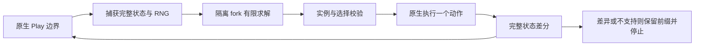

# CombatSolver 最小策略闭环：实现与验证

2026-11-04。本轮完成普通 Ironclad 战斗的「捕获 → 求解 → 原生执行一步 → 差分核对 → 重新求解」。这是一个受限的接入验证；整场战斗、第三幕 Boss 和 M1 尚未完成。

## 已取得的实证

正常原生开局、Neow 选择和地图进入均由现有宿主执行，没有编辑牌组、生命值或资源。固定种子 `LAB_V0111_NATIVE_DEV_01` 的首战中：

1. 第一次 CombatSolver 求解展开 96 个节点，首动作是实际手牌中的 Defend。
2. 映射到原生实例 `i15`，原生合法打出：能量减少 1、格挡增加 5、HP 不变。该期望独立于求解器评分；永久牌组、遗物、药水和全部已记录 RNG 保持一致。
3. 模拟分支和真实执行后的完整 `ContinuationStamp` 逐字相等；父 fork 和原生源状态未被预测分支污染。
4. 重复消费票据被拒绝；重新捕获实际状态，第二次求解展开 85 个节点。它建议的下一张 Strike 仅被记录，没有执行。
5. 同一最终求解构建的冻结重放完成，全部 8 条 dispatch/confirmed 记录、完整状态/RNG、动作、选择、两个求解结果及最终状态一致。

两条最终路径都为 `Ongoing / SliceBoundary`、4 个已确认根动作，退出 0。整体结果仍标 `Comparison=NotCompared`，因为开局与地图步骤没有预测认证；`solver-step.json` 单列这一次战斗动作的严格差分结果。

## 固定版本和产物

| 项目 | 固定身份 |
| --- | --- |
| 游戏 | v0.111.0 / 41cef1ea；程序集 `0861BFA1DF347538D932F22D580E75420F08082792EB914E53B4882764ACDBE9` |
| CombatSolver | 本地 0.50.1，DLL `4503D5234915B4B0C163556C6FDB4FA0C38F45796F656AB4B2C7E76A1BF7D98B` |
| 求解输入快照 | `.build/pinned-inputs/combatsolver-0.50.1-gate01/solver-lock.json`，826 个来源文件、CombatSolver 和五个 Ritsu DLL |
| 输入来源 | 已有认证产物 D5FF494B75BF670D2EFD0A335A6E87290F6C5A2C7B3C8511839CD68ACB0DFF1D；逐项核对原源码与 DLL 后复制 |
| 最终求解构建 | `50F8D1D03E1F7D3FB44DB8A58CAA08F9C690DB5DF553BEC702873ABF7BBECEEC`；`.build/native-build/solver-gate-final03/` |
| 原版回归构建 | `61FC506F367FF328289F67DE7183BD9B686DF7E8D2B6C19B7BA5DE06A4BDDA02`；`.build/native-build/solver-gate-native-regression01/` |

求解输入是原有 Lab 衍生构建，含已有通用适配扩展源码；此次没有注册 Eleanor handler，也没有加载 MyMod 或 BaseLib。五个 Ritsu 文件都被锁定，实际过程中加载了 Runtime、Settings、Shared 和 Ui 四个程序集；加载 Ui 程序集不等于创建游戏界面，`NGame.Instance` 始终为空。

MIT 与 Torch1230、hotwords123/Random Foreseer 归属保留在快照 LICENSE、构建 SOLVER-LICENSE、UPSTREAM-LICENSE 及仓库 THIRD_PARTY_NOTICES 中。游戏和其他依赖的授权独立于 CombatSolver；这些本地输入不进入仓库。

## 当前架构与适配边界

`Program` 继续负责原生 run 生命周期、实际动作和确认前缀；`NativeChoices`、房间/奖励模块及证据采集保持既有职责。`NativeSolverGate` 在真正的玩家 Play 边界调用求解核心，未调用完整 Mod 入口、公开 precombat worker、用户设置 Load/Save 或在线服务。



### 捕获、恢复与 RNG

使用 `CombatRootSnapshot.Capture` 从实际内存中的 CombatState 捕获根，使用 `ForkSimulator` 建立预测及父控制分支。捕获和求解前后分别比较 Lab 完整 State（含 run/player/event RNG）与完整 CombatSolver continuation；拒绝查询改变原生源的情况。

当前证据 JSON 是记录格式，不能直接反序列化为合法原生存档或任意检查点。重放从正常开局重新执行原生动作和选择，逐个确认状态；没有实现任意原生进程内回滚。模拟 fork 则供求解器内部搜索使用，其结果必须由后续真实执行验证。

### 动作与选择

本轮只接入无子选择的 PlayCard：同时核对模型、同模型 occurrence、完整 CardStateKey、同状态 occurrence、升级级别和实际手牌引用，再检查原生合法性。动作票据绑定 CombatState 对象、确认序号、完整原生状态和 continuation，一次消费后失效。

控制证据中名为 `staleRejected` 的测试使用 record 拷贝，拷贝同时继承了已消费标记，因此它只能证明旧的已消费拷贝被拒绝，不能单独证明未消费过期票据的拒绝原因。Core 的原生票据过期检查仍通过；求解票据的独立过期控制须在后续阶段改为保存消费前的独立票据后再跨动作验证，本轮不将其计作独立过期覆盖。

EndTurn、UsePotion、primary/nested/turn-start choices、额外 replay、结束回合的牌及附魔牌字段在本轮入口中明确拒绝；不会交给原有首项选择器代答。13 项实际映射负控验证拒绝且零额外派发。下一张有目标 Strike 未执行，因此敌方目标映射、非零重复实例和生成卡不属于本轮已验证覆盖。

### 宿主和审计

默认构建仍禁止 CombatSolver、MyMod、BaseLib 和 Ritsu。独立 `SOLVER_GATE` 构建使用已有 OfflineSearchHarness 内部友元接口，只从构建输出加载逐个哈希锁定的六个依赖；仍拒绝 MyMod、BaseLib 和未列出的依赖。没有把 Lab 伪装成 gameplay-neutral Mod，也没有更改求解器的未知补丁审计。

本轮没有新增 CombatSolver search patch；既有原生宿主补丁清单仍在每次边界校验，MemorySaveStore、SaveProgress/Replay 拦截、Steam 未初始化及无 UI/遥测条件保持。更复杂生命周期可能需要已有搜索隔离补丁，必须逐个检查真实目标与兼容性后再启用。

策略模块明确属于 **Oracle**，记录在 `solver-profile.json` 和捕获事件中。原生 trace 顶层的旧 `information` 字段仍描述旧开局策略；它不足以描述新增求解模块，后续扩大策略接入前须统一升级该标签。不能据此把本轮称为玩家可见信息策略。

## 验证范围与执行账本

原始账本：`.build/runs/solver-gate-work01/ledger.json`。注册于 00:59:48 UTC，停止门为 4 次原生执行、20 分钟、2 GiB；每次原生进程硬上限 120 秒。

| 次数 | 用途 | 结果 |
| --- | --- | --- |
| 1 | 首个接入试跑，构建 final02 | 闭环成功；后续补全生产证据契约，保留为早期证据，不混入最终构建结论 |
| 2 | final03 实时执行 | 4/4 已确认根动作；一步实际差分和第二次求解通过 |
| 3 | final03 冻结重放 | 完整状态、RNG、求解与动作记录一致 |
| 4 | 独立默认原版构建 | 既有正常开局→首战胜利→原生奖励→下一战 Play，24 动作通过；未加载求解器或 Mod |

原生累计运行 9.533 秒，最后一条路径于 01:05:12 UTC 完成，距注册 324.065 秒。四次名额已用完；此后只进行证据检查与文档收尾。

收尾目录统计为 145,175,471 bytes，含本轮输入快照、所有失败/成功构建、执行及控制证据；加 5 MiB 文档/Core 增量余量后为 150,418,351 bytes，低于 2 GiB。额外的启动前控制确认四次名额耗尽后拒绝启动、账本不变、未创建第五码目录；它没有启动游戏进程。

- `verification.json`：56 项独立原始证据、完整重放、构建/源码/输入及字面 Defend 规则检查，零失败。
- `production-reader-controls.json`：13 次实际生产检查器控制，3 个正常/等价接受、10 个损坏拒绝；包含缺查询、重复结束、查询错序、实际实例错配、空比较、资源/RNG 矛盾、联合状态篡改和必需快照缺失。名为 `query-rng` 的早期控制实际修改金币；另有 `actual-rng` 明确修改 RNG counter。
- `profile-api-controls.json`：8 项真实配置方法的托管 API 控制；默认配置拒绝四类依赖、求解配置拒绝两个 gameplay Mod，正确哈希通过、错误哈希拒绝。没有启动原生对局。
- 默认原版原始证据检查 22 项通过；Core 98 项通过。Core 首次控制台运行后另执行一次以保留 `core98.log`。
- 原有 15 个锁定输入、52 个兼容源码无变化。未运行大规模 Mod 回归或全原生矩阵，因为此次范围是独立求解配置与普通战斗最小闭环。

final01 编译因缺少命名空间引用失败，未启动原生执行；final02 修正。最终求解构建保留 1 条 CS0436 警告，来自 Publicizer 的 IgnoresAccessChecksToAttribute 与 CombatSolver 导入类型同名，0 错误；默认原版构建 0 警告/0 错误。没有以消除警告为由修改依赖。

## 复现与下一阶段顺序

已有结果可直接重验，不再启动本批原生进程：

```powershell
python tools/native-run/verify-solver-gate.py
dotnet .build/native-build/solver-gate-final03/bin/Release/net9.0/OfflineSearchHarness.dll --review .build/runs/solver-gate-exec-02
dotnet .build/native-build/solver-gate-final03/bin/Release/net9.0/OfflineSearchHarness.dll --review .build/runs/solver-gate-exec-03
```

后续实施顺序：先统一 Oracle/策略元数据并补独立未消费过期票据控制，补针对型动作、EndTurn 和真实子选择的窄执行桥；复用已有 PlanAction/PlanCardChoice、NativeChoices 和旧回放适配经验，保留请求身份与字段全消费。再按影响验证回合调度、自动打牌、复活、药水及生成对象，最后将在线单步决策挂到一般战斗循环，以原生终态判定整场结果。未知预测可选择明确停止，或未来声明为 native-only fallback；两者需独立计数。

时间/节点耗尽与不支持均不能成为成功：当前预算边界不采用候选；查询有 5 秒软预算和 10 秒协作取消，另有 120 秒进程树硬门。此次实际查询没有触发耗尽/取消，未重新执行超时故障注入。

整场、TestSubject 三形态、跨战策略收益和最终 RunVictory 仍待验证。即使未来求解器找到预测胜利，也要真实执行奖励、终局事件和 WinRun，再完成 M1 同构建全套验收。不会由有限节点结果推导全局最优或胜率。接入成本当前主要在严格动作/选择执行、生命周期隔离和证据标签；许可与版本锁已可复用，当前普通状态捕获未发现审计冲突。

本轮未操作游戏 UI、真实存档、其他项目或远程仓库；没有提交推送。
