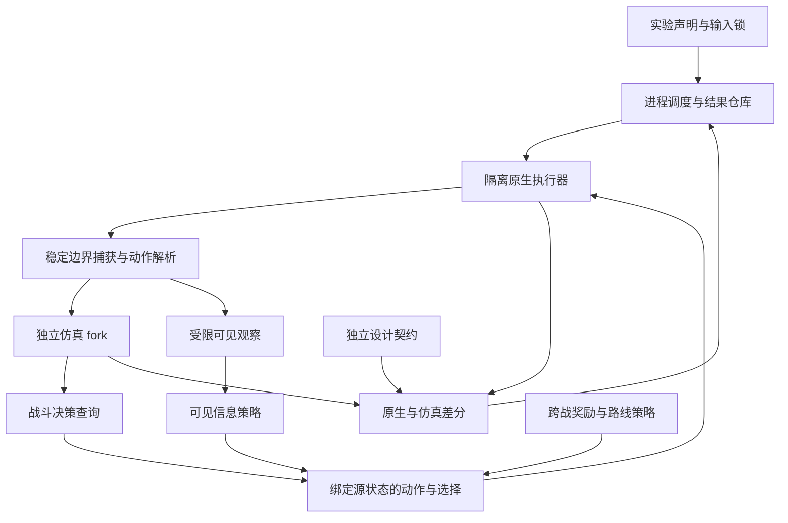

# Simulator-Lab 长期路线图与推进门槛

审查日期：2026-11-02。本文是规划，不是实现完成声明；本轮仅阅读代码、现有报告及锁定输入，并新增本文，未执行游戏验证或更改运行实现。

**建议主轴：把项目建设为可信、可复现、能回答设计问题的离线实验室。** 保留原生游戏执行作为行为参照，使用独立仿真分支快速试探，让策略层通过明确接口使用两者。先把失败也测准，再扩大机制和生命周期，逐步形成可靠的角色实验与首幕策略评估能力。

本文以 **事实 F、建议 R、假设 H** 区分结论。已有通过证据只覆盖指定版本、场景、动作与配置；未来验收标准均为建议，不代表已经实现。编号 E 对应末尾的证据索引。

## 1. 当前基线：已经能做什么

**F：工作区 HEAD 为 `2d8b7362b8f344b7be85178c82541ceb967cb713`；本地 `origin/main` 引用为 `2c819510817f64f7fddc7d315b05282f6463f528`。** 本轮没有联网重新确认远程。现有 19 个未提交项目文件构成最新能力的一部分，不能仅凭 HEAD 重建这些结果。本轮规划将它们完整保留。

游戏固定为 **v0.111.0 / 41cef1ea**，游戏 DLL SHA-256 为 `0861BFA1DF347538D932F22D580E75420F08082792EB914E53B4882764ACDBE9`。Eleanor 固定为 **v0.4.1-forms-cardpool.fix**，DLL SHA-256 为 `949320F651298D34399335EB28176578D270139DFF2CCE60FB7FDF35E7DBAD42`。本轮只读复核其 15 个锁定输入，哈希不匹配数为 0。

| 已验证事实 | 证据范围 | 不能据此推出 |
| --- | --- | --- |
| 原版单战原生／仿真至 Victory，包含敌方行动及随机目标重放；旧 Eleanor 保留回归 | E1、E6 | 所有原版角色、敌人、卡牌或随机种子均受支持 |
| Eleanor 两战原生闭环、原生领奖、合法节点、实际抽到并打出 ManaShield | 五进程、41 项检查；含非零 Record/Echo 清理夹具，E5 | 任意奖励牌、所有节点或整局已支持 |
| ManaShield 普通／升级 × Mana 0/1/2，各两次 | 12 次执行、6 项重复比较；无魔力 Block 5，支付成功普通 10／升级 13，E2 | 额外能力／遗物组合已覆盖，或这些夹具是自然领奖 |
| 三个预先声明种子 × skip/take × 两次 | 12 条路径中 8 条两战 Victory、4 条 unsupported，30 项检查通过，批次退出码 2，E3 | 胜率是 8/12；unsupported 是死亡；12 条是 12 个独立样本 |
| 原失败路线的冻结重放实际生成并打出 Slimed | seed 2 skip 两次在第 4 回合打出，完整差分与父 fork 检查通过，E3b | 所有生成、复制、变牌和重复同名卡身份均已正确 |
| 每步执行后重新求解 | 原种子 card-skip 第二战；两次各 9 个查询／9 个实际动作，另一次零查询冻结重放，15 项检查，E4 | 首次接入 CombatSolver、任意场景在线策略、全局最优或玩家可见信息策略 |
| 无 UI 的最小 Mod 发现／牌池前置路径 | 真实 manifest 与程序集关联、BaseLib 原始发现补丁、Pool 查询及 first draw，E7 | 完整 BaseLib/Ritsu 初始化、全部 Godot 场景、零售渲染兼容性 |

12 条批测路径对应 **3 个不同、预先指定的种子，6 个 seed-policy 条件，每条件 2 次执行**。这些种子不是已证明代表总体的随机样本。其中 4 个条件完成两战，2 个条件在新奖励牌覆盖边界停止。第二次执行主要是冻结路线重放，不是第二次独立寻优。两个 unsupported 条件分别领取 ReturnFlow 和 ManaConversionPrinciple；原生领奖和进入第二战已发生，后续覆盖策略明确停止。

**F：证据并非全部来自同一最终 harness 二进制。** E3/E3b 的 harness SHA 为 `85FDDCB1425E7D121B688341D7D96B376CB89EBCF87ACBB43F32B9CCD3C612A1`，E2/E4/E5 的最终构建为 `E3836899E656574E8055DBCFEFF669FB4115F675FB1BD2C4E245F342248FC2C0`。游戏和角色 pin 相同，但发布与复现仍须保留这层区别。

## 2. 技术债审计与优先级

| 优先级 | 事实／证据 | 工程含义与建议 |
| --- | --- | --- |
| P0 | `EleanorV040Probe.RunVictoryReplay` 的 EndTurn 遇 `AdvanceRound` 返回非 `None` 即停止；原生执行后又要求抵达下一玩家 Play 边界。虽有 death 字段，E3 未出现实际死亡 | 死亡路径尚未闭合。先补真实致死敌方阶段、致死自伤／维持失败的终态捕获、清理与无奖励行为；同时审查敌方阶段获胜。不能把预测死亡当实际死亡 |
| P0 | `NativeCombatDecision` 固定 1000 nodes／5000 ms；`NativeSecondBattle` 的 90 秒只在下次查询前检查，48 步／12 回合均未被测试触发 | 预算耗尽、取消与超时需成为可重放、可分类的结果；没有动作和有合法候选但预算耗尽是不同情况。当前 90 秒不是硬进程期限 |
| P0 | `ManaShieldBoundaryProbe.expectedBlock` 从运行中的卡牌 DynamicVars 计算 | 已检查原生／镜像一致和支付规则，但某些数值或升级错误可能双方同错。保留动态值诊断，增加独立版本契约表及设计意图断言 |
| P0 | 结果散落在不同 schema、异常字符串和 exit code；批测允许 unsupported 同时 correctnessChecksPassed=true | 建立统一的终态、覆盖、差分、停止原因多维结果。检查通过不等于覆盖完成；不能让 prefix 一致掩盖未执行的后续动作 |
| P1 | 动作回放主要解析 kind、turn、cardId、cardOccurrence、targetIndex；Guide 的选项由 `_selectedForm` 配置控制，镜像也读取同一配置 | 当前不是完整的子选择决策接口。扩奖励卡前建立选择请求、实际候选、选择 ID、数量与动作源状态的明确契约 |
| P1 | 生成卡已采用各世界按首次观察顺序分配的稳定序号，并补了唯一手牌身份解析 | 这是有效的局部修复，但多张同名不同状态、生成顺序与观察顺序不同、复制／变牌／移除再生成仍需专项验证；不能仅靠卡名或 pile index 做长期身份 |
| P1 | `CombatObservationProjector` 和 `IPlayerVisiblePolicy` 已存在；当前 adapter 标为 OracleReplay，未见生产策略实现通过可见观察端口执行 | DTO 隐去 draw/RNG 的检查不是策略无信息泄漏的证明。可见观察还需补合法可见 Mod 状态、遗物、选择与动作标识；意图字段也需逐项确认可见性 |
| P1 | `CombatRootV1.Fork()` 是 JSON DTO 深拷贝；`ICombatSimulator` 是契约。当前原生／仿真接入主要在 validation harness | 不应把 DTO fork 当运行时 fork，或声称已有通用独立模拟内核。先逐步把已工作能力封装成接口，避免全面重写 |
| P1 | 状态仍大量依赖 CombatSolver 完整 continuation 文本；当前 adapter 写入结构化卡牌状态时只保留整数 DynamicVars，History/Mods 等字段并非都由此 adapter 显式填充 | 现有严格比较不能删除，但公开结构化状态仍不完整。采用 schema 版本化逐步提升可诊断字段，区分全状态快照、可见观察与搜索特征 |
| P1 | v0.4 runner 的 cache revision 主要取 Lab overlay／harness 文件哈希；外部 CombatSolver 先检查版本字符串，再锁定复制后的 source | 补完整上游 source tree／项目／工具链和构建配方指纹。相同 0.50.1 字符串不足以证明输入相同；构建产物应不可变且可定位来源 |
| P1 | `NativeModProgression` 同次 run 选择排序后的合法 Monster 子节点；原生 run 状态和大量注册／选择状态使用静态对象 | 当前跨战分支依靠独立进程重跑。不要在同一 RunManager 上假装任意 fork；先用冻结前缀在不同进程做反事实实验 |
| P2 | `EleanorV040Probe.cs` 约 174 KB，旧 Eleanor probe 约 112 KB；多个 PowerShell driver 重复启动、锁与汇总逻辑 | 抽取结果、输入、生命周期与适配注册职责，先保留行为、证据与调用边界，随后再优化。不要同时做大重构和新机制 |

上述是范围内的风险定位，并非发现了所有未验证场景必然错误。R：按“错误会否污染后续实验结论”排序，终态、信息边界、动作身份优先于扩大卡池或增加搜索算力。

## 3. 产品边界与四条独立评价轴

**R：主要用户流程**应是：指定合法本机输入与版本锁 → 选择现有机制／真实 run 或明确夹具 → 声明策略、信息模式、种子和预算 → 批量执行 → 浏览结果、首个差分、失败重放与实验对照。首个产品形态采用 CLI 与本地静态报告即可；图形界面只有在能明显减少定位成本时再做。

无 UI 意味着不靠打开游戏界面、点按钮推进。它**允许依赖合法本机游戏程序集**。原生引擎负责参照执行；仿真用独立分支负责预测和搜索。短暂人工游戏冒烟由用户完成，用于资源、牌池展示与实际集成，不能替代自动化差分，也不能被自动化通过所替代。

| 评价轴 | 应记录的指标 | 不能混用的结论 |
| --- | --- | --- |
| 模拟忠实度 | 可比较动作数、根／continuation／RNG／事件差分，首个分歧、隔离与审计控制 | 搜索找到了胜利不代表模拟正确 |
| 覆盖率 | 明确分母的机制／组合／阶段／动作／节点矩阵，支持、未测、unsupported 和环境阻塞 | 适配 handler 存在不代表整张牌或整个角色支持 |
| 策略质量 | 同版本、信息、预算、预设评估集下的实际结局、损血、资源与机会成本 | 覆盖夹具的保守拖回合策略不等于实战策略；Oracle 表现不是玩家能力 |
| 性能与稳定性 | 冷启动／构建／捕获／fork／搜索／原生执行／日志分项耗时，节点、分配、内存峰值、超时率 | 同一条更短路线不能证明内核变快；更多节点不保证更强 |

近期非目标：脱离游戏程序集重写全部 STS2、全 Mod 兼容、多玩家、自动操作零售存档、直接做整局最优搜索、根据几个种子下平衡结论、自动实现六张 Echo 候选。远期可扩展第一幕和更多角色，但每次扩展都应有能力边界及独立验收。

## 4. 架构方向与替代方案

**R：采用双执行路径、共同协议、独立计算的架构；先包裹现有实现，再渐进迁移。** 下图是目标职责，不是现有模块完成图。

| 层 | 所有权与边界 | 现有起点 |
| --- | --- | --- |
| 协议与实验核心 | 无游戏依赖；版本、动作、选择、结果、覆盖、manifest、导入验证 | `src/SimulatorLab.Core`；保留 .NET Core 检查 |
| 原生执行器 | 独占一份 run，执行真实命令、调度、奖励与节点；只在稳定边界响应命令 | `NativeModRunLoop`、`NativeModProgression`、原生 probe |
| 版本后端 | 固定程序集／方法／补丁与环境 seams；清楚区分原生能力和 TestMode 特例 | 当前 v0.111.0 host profile、overlay 与输入锁 |
| 仿真后端 | 独立可变状态与 RNG，支持分支销毁；不把真实 ManaRuntime 当分支状态 | 当前 CombatSolver fork 与 Eleanor mirrors |
| 适配包 | 声明绑定版本、方法、效果、序列化、fork、选择与生命周期能力 | 先整理 Eleanor v0.4.1，保持 v0.3 基线独立 |
| 决策层 | 接收声明的信息与预算；只返回候选、理由、边界和源 token，不直接修改 native | `NativeCombatDecision`、现有 `ModRuntime.RunSearchDetailed` |
| 调度／报告 | 每进程输入、日志、超时、重放与聚合；不把策略死亡作为引擎错误 | 现有 PS drivers，逐步收敛到一个 runner 契约 |

共同协议可以共享序列化、标识和比较器；**不能共享最终状态变更实现作为差分两端的全部计算依据**。某些 branch adapter 复用角色纯状态 API 时，原生／仿真仍共享了行为来源，需要独立契约补证，不能宣称两套完全独立业务实现。

| 备选方向 | 优点 | 主要代价 | 建议 |
| --- | --- | --- | --- |
| 当前最小 headless native + CombatSolver | 已有真实证据、成本可控、能持续为 Eleanor 提供反馈 | 版本绑定、部分 UI/native 依赖、适配维护 | 主线 |
| 单纯原生反复重放做搜索 | 行为参照直接，适合端到端及反事实验证 | 初始化重、全局状态多、任意回滚难 | 作为正确性与少量候选验证路径，不做指数搜索主体 |
| 全量独立重写游戏规则 | 潜在可移植与批测速度高 | 大量规则、隐藏状态与更新负担，短期削弱可信度 | 当前不选；只有具体热点的投入产出有测量证据才局部替换 |
| 完整 Godot 引擎 headless host | 可能解决后续必须依赖真实引擎服务的路径 | 额外资源、初始化、文件副作用与新环境验证 | 保留为候选后端；遇真实必要依赖再做独立可行性试验，不为进度随意扩 stub |

**R：默认隔离单位是进程。** 一次构建产生不可变产物，每个 native case 独立进程、独立工作输出；同进程内只允许经证明隔离的仿真 fork。更多 worker 是未来吞吐优化，必须先测单 worker 再配置并发上限；不要让多个会话覆盖同一缓存 DLL、共享 mutable Mod 单例或复用实际 RunManager 分支。

每个 headless seam 应登记目标方法／版本、为什么仅属环境或展示、允许调用次数／阶段、异常时停止条件及验证。奖励、伤害、选择效果、RNG、生命周期不得被 UI stub 代替。需要扩大文件访问、初始化未经验证宿主服务或放松安全审计时，形成具体提案并停在该依赖处。

## 5. 状态、RNG、动作与结果契约

**R：区分四份数据。** 完整执行快照服务于差分与重放；玩家可见观察服务于策略信息约束；搜索特征服务于排序；run 持久状态服务于跨战延续。不要用一个缩减 DTO 同时替代四者，也不要把字符串哈希相等当作字段完整性的证明。

稳定边界应显式说明：所属 run／combat／回合、阶段、动作队列是否清空、挂起选择、原生和 adapter 版本、注册 stamp、RNG 范围、是否终态及捕获位于 teardown 前还是后。Root token、动作 token 和版本必须相互绑定。原生动作执行结果不确定时，先核查该进程状态／轨迹，不能直接重发可能已经执行的动作。

**动作与选择建议：**

- 卡牌以实例 ID 和状态前置条件为主；手牌 index、同名 occurrence 仅作该快照的诊断和底层 API 参数。目标用稳定战斗实体 ID，再在执行时解析原生索引。
- 生成／复制／变牌记录来源动作、生成序号、旧新实例关系及永久牌组链接。首轮先完善身份测试；事件来源无法可靠捕获时继续显式 unsupported，不用名称相等补洞。
- 子选择要有 ChoiceRequestId、上下文、实际候选 ID、顺序、最小／最大数量、允许跳过与选择 token。可按状态机分步，或将复合动作附带选择计划；必须由真实候选验证，并暴露每个暂停／恢复点。
- 验收覆盖相同名称不同升级／费用／附魔、不同 pile 同名、抽取后索引变化、多个新对象、变牌、销毁、战斗结束后旧 token、错误 combat 和重复提交。Guide 固定选项升级为动作绑定的真实选择能力，保留固定选项夹具作回归。

**RNG 建议：** 继续保留九个战斗流，补齐跨战奖励／地图／遭遇／玩家 RNG 与相关 odds、历史及重排事件的审计清单。每条轨迹记录算法、状态、消耗计数、所属作用域与原生事件对应；搜索用独立 policy RNG，不能消耗 native RNG。种子、输入和动作相同才检查逐状态确定重放；时间预算和并发可能影响搜索路线，须分别报告“动作重放确定性”和“求解器重复选路稳定性”。

**R：结果采用多个正交维度，同时保留简明主原因。** 建议至少包含 native outcome（Victory／Death／ongoing／unknown）、comparison（exact／mismatch／not-compared）、coverage（complete／unsupported／not-run）、stopReason 及首次失败动作。主原因含 Victory、Death、Unsupported、BudgetExceeded、InvalidAction、EngineError、DifferentialMismatch、EnvironmentBlocked、Cancelled、Interrupted；不要把所有非 Victory 汇成 failed。

| 结果例子 | 正确解释与行为 |
| --- | --- |
| native 与 sim 均真实死亡且完全匹配 | 语义通过，策略死亡；不能领取胜利奖励 |
| sim 预测死亡，native 尚未执行 | 原生结局 unknown；不是已验证 Death |
| 预算耗尽仍有合法候选 | 报告预算与候选状态；是否执行由事先声明的策略决定 |
| 没有候选或尚有未决选择 | 停止并保留边界；不能悄悄 EndTurn 冒充 solver 结果 |
| 当前动作完全匹配、下个效果 unsupported | 前缀 exact，整体覆盖不完整；保留分母 |
| 动作只执行了一部分就异常 | 记录最后确认边界与未决状态，隔离该 worker，禁止盲目重试 |

批次 exit code 是自动化入口，不是全部语义。保留现有 0／1／2 的兼容映射或明确迁移；完整报告必须区分“按预期得到死亡／预算停止的测试通过”和“策略成功”。安全 guard 调用次数应按生命周期事件验收，不能把两战的 2／4 次硬套到三战或死亡路径。

## 6. 正确性门槛：避免双方同错

| 验证层 | 证明什么 | 近期具体用例 |
| --- | --- | --- |
| 独立版本契约 | 行为／数值与已审阅契约一致 | ManaShield 独立 5／10／13 与升级变化、能量／Mana 支付；临时 Recording 到期而 Echo 战内留存；Reverse 自有属性撤销不误删外部来源 |
| native／sim 差分 | 实际动作与预测一致 | 每动作前后、敌方阶段、子选择、终态前和清理后；保留完整状态与结构化差分 |
| 性质／变形测试 | 大范围不变量与边界关系 | fork 后 parent 不变；相同输入重放一致；增加无效信息不影响 PlayerVisible；不可移除／变牌对象不进入合法候选 |
| 轨迹回放 | 修复真的触达原失败点 | 保留 Slimed 原失败路线；失败后的重新求解找到新胜利不能替代缺陷回归 |
| 受控变异测试 | 检查器能发现故意引入的错误 | Lab 测试副本中少扣 Mana、错升级量、错 RNG 消耗、错 pile、漏清 Echo、保留过期选择、错 manifest／注册签名；每个变异都应被指定 gate 杀死 |
| 宿主集成前置 | headless 环境仍执行目标语义 | 真实 Mod 身份、所有 starter Pool 查询、首次抽牌、原生奖励选择、MemorySaveStore、存档／replay 拦截 |

变异只作用于受控测试副本／测试适配器，不能改角色源、正式 pin、游戏安装或放松正常审计。合成 PatchInfo 控制继续注明“元数据测试”；只有真实 patch 安装／拒绝／移除才记 actual weave 证据。

独立契约要记录依据、版本和审阅者，不能从当前 mirror 的输出自动生成期望。原生游戏与设计契约冲突时，先报告“实现行为／设计意图不一致”；由角色项目决定是否修改，Lab 不擅自改变玩法。属性测试也应带前提：例如加牌、增加力量、提升伤害不一定在所有遗物／触发组合下单调变好，不能把直觉当通用定律。

每次变更先运行最小失败重放与针对性契约，再跑受影响模块，最后跑发布闸门。没有新变更或未解风险时不重复成功的大套件。差分失败应保存首个不同字段、动作、选择候选、before/after 根、RNG 与可最小化的序列；缩减器只能删减仍合法且保留失败的动作，不能改真实结果来让重放通过。

## 7. 分阶段路线：按验收推进，不按未经测量的日期承诺

| 阶段 | 交付物与依赖 | 可接受的完成条件 | 停止／回退条件 |
| --- | --- | --- | --- |
| P0 证据与输入基线 | 登记当前工作区、19 文件、全部结果／源码／工具链／上游输入指纹；独立保存现有报告 | 每个结论能定位到输入、harness、动作与结果；旧失败保留，明确哪些结果不是同一构建 | 缺输入／源码来源先补齐，不覆盖旧 pin；是否提交／推送另按授权执行 |
| P1 终态与失败闭合 | 依赖 P0；统一结果模型、Death／敌方阶段 Victory、预算／取消、无候选、错误与过期 ticket | 既有 Victory 不回退；致死动作实际执行并捕获清理前后；无胜利奖励；预算停止和错误不得伪装 pass；失败报告可重放 | 无法确认动作是否发生，或需跳过审计时停止该路径，先恢复可信边界 |
| P2 稳定动作／选择与适配边界 | 依赖 P1；Choice 契约、生成／复制／变牌身份、多版本能力登记；逐步抽离 probe 职责 | 同名不同状态、多个新对象、父 fork、过期选择等正负用例通过；旧 traces 仍可按其 schema 读取；不改语义的大重构和新卡分开验收 | 任意靠名称猜对象或全局真实状态执行 fork，退回显式 unsupported |
| P3 可信 Eleanor 两战切片 | 依赖 P2；先接 ReturnFlow，再 ManaConversionPrinciple/ManaEssence 的实际依赖；保留原 3 种子声明 | 原 4 条 unsupported 越过既有覆盖停点，或保留更精确阻塞；非强制 Victory。新牌实际动作由独立覆盖用例保证，不强迫冻结策略选它；牌组／选择／资源／清理契约通过，自然流程与夹具分开 | 不为全绿换奖励／种子，不为通过而改角色设计；新依赖过大则拆出可审查小里程碑 |
| P4 实验与战斗策略评估 | P1 后可准备声明；可信机制要求 P2/P3 对应 gate；可见信息层分开验收 | 冻结覆盖策略、冻结回放、在线策略有独立标签；窄实验能回答一个问题并报告不确定性；PlayerVisible 通过反泄漏测试后才按该模式发结论 | 效果由不同预算、覆盖约束、隐藏信息或大量 unsupported 主导，则停止因果／平衡结论 |
| P5 通用多战生命周期与节点 | 依赖 P1/P2；将硬编码第二战变为 bounded run controller；逐类节点见下表 | 同一实际 run 可完成预设三场及以上战斗／节点链，或真实死亡／明确停止；每次清理和持久资源延续可追踪；节点测试独立于策略强弱 | UI seam 跨入游戏语义、RNG／历史不能追踪时，停在前一支持边界 |
| P6 固定首幕闭环与跨战策略 | 依赖 P5 所需节点、敌人／遗物／卡支持；先预设合法路线，再有限候选策略 | 预先声明自然首幕路线实际走到 Boss 结算或 Death；奖励／路线决策有预算、信息约束与可解释日志；未知节点保留分母 | 有选择性删样本、全树爆炸或未经证明的 run fork，退回固定路线／有限候选 |
| P7 可持续本地产品与扩面 | 随 P0–P6 渐进完善；达到可重复安装／运行再扩更多角色、幕、版本 | 新本地工作目录可复建并复现；Core 公共检查与合法本机集成检查分层；跨版本有独立锁与迁移证据 | 来源／许可证／版本证据不完整则不发布相应内容；性能优化若破坏正确性立即回退 |

P4 的声明／分析工具可在等待某张卡适配时推进；P5 不要求先优化策略。所有下游都继承 P1 的终态和错误语义，不允许靠“这次只测胜利”长期绕开它。

**节点依赖顺序建议：**

| 顺序 | 最小纵向场景 | 原因与验收重点 |
| --- | --- | --- |
| 1 | 普通战斗 → 奖励 → 普通战斗，推广到预设 N 场 | 先验证循环控制、重复 teardown、跨战 deck/relic/HP/Gold/RNG，避免重复拼装两个独立战斗 |
| 2 | 休息节点：休息、升级、合法跳过 | 复用原生 HP／upgrade／选择；升级永久牌必须在下战生效；不把临时副本升级当永久升级 |
| 3 | 宝箱／固定遗物奖励，有限已支持精英 | 增加 relic 生命周期与战斗模型覆盖；只领取真实生成奖励，未知 hook 显式拒绝 |
| 4 | 单个确定性事件，再单个有随机结果的事件 | 先解决选项条件、付款、HP／牌组变化和退出，再记录事件 RNG；Unknown 地图点必须经过原生解析 |
| 5 | 商店小切片：一次购买、移除、离店 | 依赖金币交易、真实价格／库存、选择、永久移除规则；之后才扩折扣、刷新、多次购买等 |
| 6 | 首幕合法路径、Boss 与幕末奖励／边界 | 先验证已声明路径；完整首幕节点覆盖与跨幕支持另有清单，不把一条成功路线称作首幕全覆盖 |

若某自然种子必须经过尚未支持节点，应记 unsupported 并保留路线。可另建原生 API 节点夹具来开发该类型，但必须标明它是夹具，不能替换原自然 run 并仍称同一次自然流程。

## 8. 决策层：战斗、跨战与信息模式

**R：战斗继续采用有限预算的闭环搜索。** 每步检查源状态和合法性，实际执行后复核，再求解。先保证不同预算下的停止语义与合法首动作，然后才比较 beam、排序、分支上限、缓存和搜索算法。各策略共享同一裁判与资源预算接口；合法动作枚举不应随评分偏好偷偷删去选项。

**R：跨战采用分层有限候选评估。** 奖励／路线层先枚举真实可选项并排除非法项，再以明确特征排序，选择有限候选做短视窗 rollout；预算随需要分配，记录裁剪理由和未评估项。战斗层负责候选后续战斗执行。暂不把每张奖励 × 每个节点 × 每步战斗动作做笛卡尔积穷举。

首个跨战对照应包含固定合法策略和简单可解释规则作为基线，再比较有限 lookahead；之后有足够数据才考虑采样树搜索、价值近似或学习策略。没有可信评估集之前，训练和更深搜索会加速利用模型缺口。

原生 run 的反事实分支先通过**独立进程重放相同前缀**获得相同奖励选择点，逐候选执行真实选择。可在仿真层缓存经过验证的战斗结果；缓存键至少包含完整相关状态、输入／adapter 版本、信息模式、策略与预算。任意原生 RunManager snapshot/restore 仍是未来需独立验证的能力，不能从现有 combat fork 推导。

| 信息模式 | 允许用途 | 必须执行的限制 |
| --- | --- | --- |
| OracleReplay | 准确差分、机制诊断、已知状态下的搜索实验 | 标注全状态／未来顺序／RNG 可用的程度；不能称作玩家可实施策略或严格数学上界 |
| PlayerVisible | 面向实际决策的策略比较 | 策略只接受审定可见观察与自己维护的记忆／policy RNG；隐藏 draw/RNG、日志、root digest、缓存都不能成为旁路 |

PlayerVisible 必须补：可见状态完整性、手牌／目标的可执行 ID、已知牌组信息与合法选择；避免只给删减 DTO 却缺少 Eleanor Mana/form/Echo 等必要观察。测试方式是构造可见状态相同、隐藏状态不同的成对世界，用相同 policy seed 检查行动一致或分布一致；策略不得读取 native 对象或 Oracle cache。用于搜索的隐藏世界采样应依据可见知识，而不是把真实未来顺序偷渡进去。

**关于“端口化”：** 在架构上，它指动作、观察、状态和预算接口；在构筑分析上，建议把卡牌／遗物机制表示为有条件的输入／输出特征，例如 energy/Mana 消耗、抽取与选择、攻击段数、实际未格挡伤害、Block、Recording、Echo、触发时点与持久范围。记录连接条件、支付失败路径、容量与触发次数，不把“两个同色标签相连”当作协同已成立。

这些特征可解释瓶颈、候选排序和实验分层；**不是已验证胜率公式**。循环、资源溢出、手牌空间、费用和敌方行为会使简单相加失效。应以实际执行的资源流量、触发利用率及消融实验检验特征作用；排序收益必须在留出数据中验证，原生效果仍由真实规则执行。

## 9. Eleanor 如何持续产出设计价值

**R：维护两条互相约束的主线。** 原版 Ironclad 基线检查 Lab 的通用战斗／RNG／节点能力；Eleanor 用多资源、形态、来源 ledger、选择与变牌考验扩展能力。新增通用能力先有一个原版小用例，再有一个 Eleanor 压力用例；角色特有状态留在版本化 adapter，不固化进通用协议的默认玩法。

当前两张奖励卡并非孤立数值镜像：锁定实现中 ReturnFlow 支付 Mana 后依次进行两个 pile 的原生选择和取回；ManaConversionPrinciple 通过真实候选过滤、CardScope 生成 ManaEssence 并变牌，升级还传递给新卡。建议在 P2 的选择／身份基础上接入，验收空 pile、支付失败、同名候选、升级、不可变牌对象、临时／永久牌链接及随后实际打出结果。具体枚举值和效果必须再次依据锁定 SDK／实现确认，不能凭卡名补写规则。

**近期窄实验建议：** “在真实提供 ManaShield 的奖励点，领取它或跳过它，对随后一战的实际损血、Mana 使用及手牌效率有什么影响？”实验只比较当前角色实现，不改数值、不加卡；预先声明样本、是否 Oracle、同一在线策略、相同预算与结局指标。

现有 take 夹具为了确保抽到并打出 ManaShield，会先防守／拖回合。它是覆盖测试，不能用 HP 61 对比 skip 的 HP 70 得出这张牌更差。设计实验中应让两边使用同一战斗策略及合法行动规则；另外保留覆盖夹具证明卡实际执行正确。报告有多少自然实验根本没抽到／没打出该牌，以及删牌成本、抽牌稀释、机会成本和支付失败，而非只统计触发时的格挡。

对照前缀可以相同，但不同选择会改变 deck、shuffle 与后续 RNG 消耗。**同 seed 不是严格逐事件配对的保证。** 保留各流轨迹和分歧时点；只有随机事件有明确一致对应时才使用共同随机数的解释，不能强行重置 RNG 或手摆抽牌维持配对。分析单位按 seed／共同前缀聚类，统计独立性还需由采样方式说明；重放只证明复现，不增加独立样本数。若存在 unsupported 或删失，先报告原分母、有效配对数量与偏差，不给“整局胜率提升”的结论。

随后可以研究：现有形态选择的收益与维持成本、Mana 支付压力、临时 Recording 时机及 Echo 利用、转换与伤害／格挡协同、现有构筑在不同敌人结构下的稳定性。每次只问一个可证伪问题，固定版本和策略；结果用于提示角色设计者下一项值得人工检查或授权试改的机制。Lab 不擅自修角色玩法，也不把六张未实装 Echo 候选加入池。

角色项目若产生新版本，发布者提供 DLL／manifest／依赖锁、变化说明和必要人工冒烟结果；Lab 建新 pin 和新契约集，保持旧基线可跑。预期行为变更和意外回归分开审阅，不能自动更新 golden 让红色消失。

## 10. 可重复基准、性能和统计规范

**R：建立三个数据层。** 永久回归集保存已知缺陷与边界；开发集用于适配／调参；预先冻结的留出集用于策略评价。样本清单在运行前保存，失败种子不能替换。新增种子按声明的抽样规则补充，不按是否胜利挑选；敌人、状态和机制分层也须在观察结果前定义。

每个运行 manifest 应包含：Lab commit 和 dirty 内容摘要、完整 upstream source 与 patch/adapter 指纹、game／Mod／依赖锁、运行时／OS／CPU 与并发、场景来源（自然／API 夹具／冻结重放）、原生 seed 与 policy seed、选择规则、信息模式、请求和实际预算、限制、配置、时间戳、报告 schema、所有计划和关键 artifact 哈希。原始绝对路径只留本地，公开示例用相对路径或变量。

报告必须给出每条路径和汇总分母：Victory、Death、Unsupported、预算停止、环境失败、引擎错误、动作拒绝和差分错误。一个动作的全状态不一致立即使该精确轨迹不通过；不通过均值、容差或抽样把离散状态错误消掉。验证单元若使用小数、浮点或舍入规则，单独声明数值契约，不能临时放宽。

性能先做分项观测：构建／冷启动、Mod 发现、root 捕获、状态复制、legal-action／choice 枚举、单节点仿真、敌方推进、求解、native drain、JSON／磁盘。采用同一硬件、同一输入与预算，分别测冷／暖运行，报告分布与样本数；样本不足时不把 p95 或最大值当稳定能力承诺。跨机器的 wall time 不直接比较。

优化顺序建议：先减少无必要构建／重复报告工作，再优化已测出的状态复制或热点；之后才考虑可验证的缓存、批次并行、剪枝、搜索算法。固定动作重放适合评估内核速度，固定预算在线执行适合评估质量／速度权衡，两者都保留。大规模批测前增加 worker 硬超时、诊断落盘、资源上限及退出确认；当前 90 秒查询前检查不能替代它。

## 11. 发布、依赖与可移植性

**F：目前仓库的 Core 无游戏程序集引用；第三方说明及 `.gitignore` 已区分本机依赖、反编译内容、原始报告和 Agent 材料。** R：保留这一边界，公开仓库只放项目代码、必要工具、合成小夹具、规范和可公开技术文档。游戏 DLL／资产／反编译源码、角色 binary、私人研究与授权记录均不混入项目 MIT 发布物。

上游 CombatSolver／Random Foreseer 的适用 MIT 许可和归属依仓库 `THIRD_PARTY_NOTICES.md` 保留；其他依赖按各自具体版本与发布内容确认许可，不因能本地加载就推导可重新分发。这里是发布流程建议，不对未审阅的新依赖作许可结论。

建议首先交付 Windows 本机可移植配置：环境变量／local config、输入发现和校验命令、精确错误提示、一个固定启动入口、版本化报告导入器。在另一个本地路径进行复建验收；跨 OS／容器是后续独立里程碑，不保证 Godot/native bindings 可直接搬迁。

CI 分两层：公开的无游戏 Core／schema／纯契约检查；拥有合法输入的隔离本机 integration runner。没有授权私有 runner 时就如实显示本机验证状态，不能上传游戏内容来换取公共 CI。研究原始报告的保留／清理策略应先登记：发布小型脱敏结果摘要和可重现配方，完整轨迹留本地归档；清理失败证据或旧 pin 需要明确保留规则。

## 12. 最近几轮的具体工作包

以下是建议队列，不构成本轮实施或提交授权；每包结束都输出证据、限制及是否可推进下一包。

| 工作包 | 有界工作 | 交付与完成门槛 |
| --- | --- | --- |
| R0 当前成果整理 | 冻结 19 文件对应源码清单、已有报告索引、不同 harness 的对应关系；按后续授权决定本地提交／推送 | 可重建的基线和可查的失败历史；不重跑无变化的成功用例凑数量 |
| R1 下一轮首要实现 | 统一结果维度；一条原生敌方致死、一条现有 Eleanor 维持／自伤致死；预算用尽有候选／无候选；过期、跨战、重复 ticket | 每个场景有明确期望 stop／outcome，死亡无奖励、队列与清理可见；现有 Victory／两战／审计回归保持；不触发死亡的路线不算死亡测试 |
| R2 动作与选择 | 将 Guide 的子选择绑定动作；ReturnFlow 的两次真实选择；同名不同状态、多生成对象及 stale-choice 负测 | 同一源状态的不同合法选择可独立执行／重放，父 fork 不变；未知选择显式拒绝；实际候选集合和选中实例一致 |
| R3 关闭已知奖励缺口 | 完成 ReturnFlow 支付／取回和 ManaConversionPrinciple → ManaEssence 变牌／升级依赖；保留原 3 种子和失败计划 | 原先四条路径越过既有覆盖停点，再记录 Victory／Death／预算／unsupported；另以明确覆盖用例实际执行新牌，不强迫原策略选牌；不用删除 seed 或绕过领取；独立契约和差分两套证据 |
| R4 首个设计实验 | 声明并运行窄 ManaShield take/skip 对照；另外逐步让有界在线模式适用于 take 与更多已支持场景 | 覆盖策略与质量策略分开；同一预算／信息；报告 RNG 分歧、未抽到情况、原始分母与不确定性；不动角色数值 |
| R5 生命周期扩展 | 将两战脚本推广为有界 run controller；首先三战，再一个休息／升级节点 | 同一次 run 的持久状态与临时资源清理连续可追踪，合法节点真实执行；失败在明确边界停止 |
| R6 及以后 | 按 P5/P6 节点依赖扩事件／商店／精英／Boss，先固定路径再做有限跨战决策 | 每次只新增一种节点契约或一类机制；完成首条自然首幕后再扩大首幕覆盖，不与全卡适配混成一个任务 |

P2 的接口抽取应服务 R2/R3，不为一个遥远通用框架重构全部代码。若 R1 的死亡需要改变核心 terminal 模型，先提交具体最小接口提案与复现点；可独立推进的契约／报告工作继续。若预算时限只能用危险中断游戏内部状态实现，则以隔离 worker 超时结束并记录 unknown outcome，不伪装安全边界已完成。

## 13. 并行会话责任与停止规则

这是未来获准并行工作时的责任设计，本轮未启动子代理。

| 职责 | 写入所有权 | 协作接口 |
| --- | --- | --- |
| Lab 协议／host 维护 | Core、原生边界、身份、错误与预算控制 | 提供版本化契约与兼容说明；一个集成负责人管理共享变更 |
| Eleanor adapter 维护 | Lab 内指定版本适配包与机制夹具 | 只读取冻结角色输入；发现角色行为问题交给角色项目，不自行改玩法 |
| 角色项目维护 | 角色源及用户授权的角色产物 | 发布新版本和 hash，说明意图变更；不得覆盖 Lab 正在跑的 pin |
| 验证／实验维护 | 独立契约、样本声明、只读评估与报告 | 不用 mirror 实现自动生成全部预期；评估集冻结，故障报告优先于调策略 |
| 集成／发布维护 | 构建锁、输入清单、最终回归、提交范围 | 一次只构建一份可变缓存，构建后发布不可变 artifact；提交／推送按当时授权 |

允许并行分析不同文件或独立进程执行已构建产物；共享 `.build` source cache、同一 Mod 单例、同一 run 输出和角色产物不并行写。使用 worktree 只能隔离代码，还需要隔离输出与缓存。模型／运行配置由调度方明确设置；报告只记录实际可验证的元数据，不根据模型自称作质量背书。

停止规则：审计失败、输入锁变化、存档后端不符、语义层被 stub、动作结果未知、差分不一致时停止相关执行；保留证据，不降级 gate 换取通过。普通未实现能力记录 unsupported 并完成独立项。出现旧回归失败时先回到最后可验证边界，以修复或撤销本次局部改动恢复；不重写已发布历史、不删除用户工作。

## 14. 默认选择、待验证假设与证据目录

当前没有需要用户先回答才能完成规划的问题。建议默认采用：Windows 本机、合法游戏程序集、固定 v0.111.0、Ironclad 加 Eleanor 双基线、先可信设计实验后策略扩面、先首幕后更多幕、按 gate 决定下一步而非按日期承诺。

后续值得用户决定的少量产品问题：首个设计实验是否采用上述 ManaShield 机会成本问题；在 PlayerVisible 尚未就绪时，是否接受明确标为 Oracle 的机制诊断报告；何时将主要投入从机制验证转向首幕策略。本文默认先产出机制诊断，面向玩家的策略结论等待 PlayerVisible 验收。这些选择不应阻塞终态／身份／报告等基础正确性工作。

**H：待验证的假设清单。** 最小 headless profile 是否能覆盖所有目标事件／商店；全 run 状态能否安全快照恢复；生成来源事件能否形成无歧义长期 ID；可见状态是否足以驱动有用的有限预算策略；端口特征能否提高留出集候选排序；跨机器／并发是否保持所需重放语义。每个假设都需独立实验，不能被当前两战通过替代。

| 编号 | 文件／符号 | 本文使用的证据 |
| --- | --- | --- |
| E1 | [MILESTONE_STATUS.md](MILESTONE_STATUS.md)、[PROBE_PROVENANCE.md](PROBE_PROVENANCE.md)、[TWO_BATTLE_VALIDATION.md](TWO_BATTLE_VALIDATION.md) | 既有能力边界、真实来源、宿主隔离和两战范围 |
| E2 | [最终 ManaShield 汇总](../.build/runs/extended-ShieldMatrix-20261102-022443-357/summary.json)、[ManaShieldBoundaryProbe.cs](../tools/validation/ManaShieldBoundaryProbe.cs) | 六组合、重复、真实 API 夹具和当前 expectedBlock 来源 |
| E3 | [三种子声明](../tests/fixtures/fixed-strategy-batch.json)、[批测汇总](../.build/runs/fixed-strategy-20261102-021310-857/summary.json)、[批测 driver](../tools/validation/run-fixed-strategy-batch.ps1) | 8/4 结果、固定样本、冻结重复、退出分类 |
| E3b | [保留失败计划的重放](../.build/runs/fixed-strategy-20261102-021549-792/summary.json) | 真实生成 Slimed 的动作解析回归；修复后新求解路线与原失败重放分开 |
| E4 | [在线汇总](../.build/runs/online-decisions-20261102-022356-476/summary.json)、[NativeCombatDecision.cs](../tools/validation/NativeCombatDecision.cs)、[NativeSecondBattle.cs](../tools/validation/NativeSecondBattle.cs) | 9 次查询、源状态绑定、实际／请求预算、48/12/90 限制与 frozen 模式 |
| E5 | [最终两战汇总](../.build/runs/eleanor-native-loop-20261102-022603-354/repeat-summary.json) | 五进程／41 检查、Record/Echo 清理和原生存档拦截 |
| E6 | [原版／旧 Eleanor 回归](../.build/runs/vanilla-m1-20261102-022000-159/milestone-summary.json) | 原版 Victory/RNG、旧角色、原版最小 run loop |
| E7 | [NativeModRunLoop.cs](../tools/validation/NativeModRunLoop.cs)、[NativeModProgression.cs](../tools/validation/NativeModProgression.cs) | 真实 Mod 关联、牌池前置、原生领奖、Monster 子节点、持久／清理边界 |
| E8 | [EleanorV040Probe.cs](../tools/validation/EleanorV040Probe.cs)：RunVictoryReplay、DispatchGuidingPower | EndTurn 非 None 停止、原生下一 Play 要求、Guide 固定选择及 terminal 字段 |
| E9 | [VanillaCombatRootAdapter.cs](../tools/validation/VanillaCombatRootAdapter.cs)、[CombatProtocol.cs](../src/SimulatorLab.Core/CombatProtocol.cs)、[RunProgressProtocol.cs](../src/SimulatorLab.Core/RunProgressProtocol.cs) | 身份、DTO fork、Oracle、可见观察、九 RNG 流、有限进度协议 |
| E10 | [构建脚本](../tools/validation/run-v0111-eleanor-v040.ps1)、[VALIDATION.md](VALIDATION.md)、[THIRD_PARTY_NOTICES.md](../THIRD_PARTY_NOTICES.md) | 本地构建／输入锁、工具依赖与许可／归属边界 |

`.build` 链接只在保留本地证据的工作区可用，原始运行产物不应随公开文档发布。ReturnFlow／ManaConversionPrinciple 行为审查来自锁定 DLL 的本地反编译视图：`.build/decompiled/eleanor-v0.4.1-forms-cardpool.fix/` 下对应类型；本文仅记录契约事实与规划，没有复制该实现或新增角色内容。保留的历史审查可供溯源，但本轮优先依据当前源码与实际结果，未开展外部无界调研。
